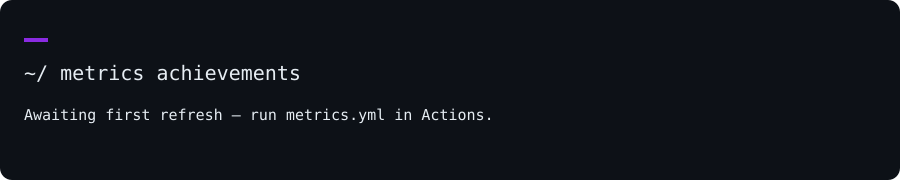

<div align="center">


**`Rachit Kumar Tiwari`** · `rachts` · `Kolkata, India`

<a href="https://www.linkedin.com/in/rachitkrtiwari"></a> <a href="mailto:tiwari.rachit@gmail.com"></a> <a href="https://portfolio-rachts.vercel.app"></a> <a href="https://leetcode.com/u/rachts/"></a> <a href="https://www.hackerrank.com/profile/rachts"></a> <a href="https://drive.google.com/file/d/1VZ8CnQdSzF9B3DEpfSfJLlMGEvfP-CiC/view?usp=sharing"></a>

</div>

## `~/` whoami

```console
$ cat about.txt
```

I'm **Rachit**, a B.Tech CSE student at MCKV Institute of Engineering (2024–2028), based in Kolkata. I build web apps and explore how voice agents, retrieval and computer vision can make them more useful. I'm looking for SDE, full-stack or AI-ML internships.

- Currently building: **Vocalis OS**, **Vitamend** and **Kred.ai**.
- Portfolio: [portfolio-rachts.vercel.app](https://portfolio-rachts.vercel.app)
- Learning: **TODO — add what you're studying right now.**

`Fun fact: TODO — add one detail that sounds like you.`

## `~/` toolbox


`Also: Gemini / OpenAI APIs`

## `~/` skill radar

 

<sub>Self-assessment, not a benchmark. TODO: set your ratings in <code>scripts/skills.json</code>.</sub>

## `~/` contribution calendar


<picture>
  <source media="(prefers-color-scheme: dark)" srcset="assets/snake-dark.svg">
  <source media="(prefers-color-scheme: light)" srcset="assets/snake.svg">
  
</picture>

## `~/` the numbers


 

<sub>Repository languages measure code, not proficiency. Achievements are calculated by Metrics.</sub>

## `~/` selected work

| project | live | stack | one-line description |
| :--- | :--- | :--- | :--- |
| **Vocalis OS** · TODO: repo | TODO | `Next.js` `TypeScript` `Express` `Gemini` `WebSockets` | An agentic voice assistant. |
| **Vitamend** · TODO: repo | [visit](https://vitamend.vercel.app) | `Next.js` `FastAPI` `OpenCV` `Pytesseract` `MongoDB` | An AI medicine donation platform. |
| **Kred.ai** · TODO: repo | TODO | `Next.js` `Gemini` `Serper API` | Evidence-backed news verification. |
| **PrivSight** · TODO: repo | TODO | `Electron` `React` `Python` `OpenCV` | Computer-vision-based screen privacy. |

---

<div align="center">
<sub><code>01110100 01101000 01100001 01101110 01101011 01110011 00100000 01100110 01101111 01110010 00100000 01110011 01100011 01110010 01101111 01101100 01101100 01101001 01101110 01100111</code></sub>
</div>
