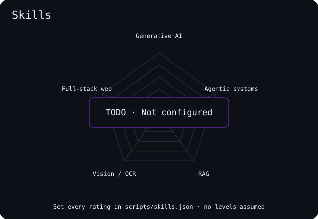
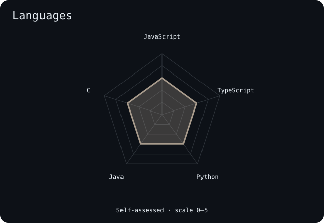
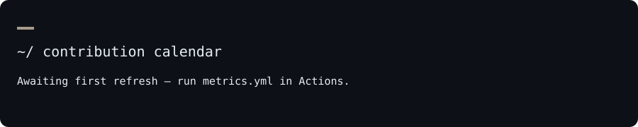
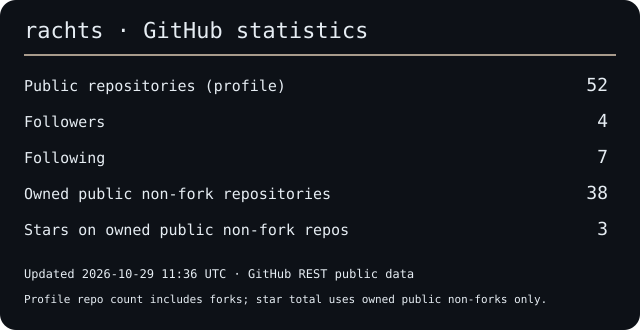

`Rachit Kumar Tiwari` · `rachts` · `Kolkata, India`

     

## About

I'm Rachit, a B.Tech CSE student at MCKV Institute of Engineering (2024–2028), based in Kolkata. I build web apps and explore how voice agents, retrieval and computer vision can make them more useful. I'm looking for SDE, full-stack or AI-ML internships.

- Currently building: Vocalis OS, Vitamend and Kred.ai.
- Portfolio: [portfolio-rachts.vercel.app](https://portfolio-rachts.vercel.app)

## Toolbox

Also: Gemini and OpenAI APIs

## Skill radar

 

## Contribution calendar

<picture>
  <source media="(prefers-color-scheme: dark)" srcset="assets/snake-dark.svg">
  <source media="(prefers-color-scheme: light)" srcset="assets/snake.svg">
  
</picture>

## Stats

## Selected work

### Featured Projects

#### [Vitamend](https://github.com/rachts/vitamend-org) — *AI-Powered Medicine Redistribution*
> Bridging surplus medicine with underserved community health clinics across India.
- **Live:** [vitamend-ngo.vercel.app](https://vitamend-ngo.vercel.app)
- **Stack:** `Next.js 15` `TypeScript` `MongoDB` `Auth.js` `Google Gemini Vision`
- **Impact:** Engineered an automated OCR pipeline to verify medicine batch codes and expiration dates, connecting 30+ donation hubs.

#### [MEDCHECK](https://github.com/rachts/MEDCHECK) — *Clinical Pharmacology Engine*
> Comprehensive medication safety platform analyzing multi-drug interactions with zero hallucinations.
- **Live:** [medcheck-official.vercel.app](https://medcheck-official.vercel.app)
- **Stack:** `React 18` `FastAPI` `Python` `SQLite (WAL)` `OpenFDA API`
- **Impact:** Built a deterministic 17-rule pharmacological validation matrix that evaluates complex 5+ drug matrices in sub-80ms.

#### [DocEasy](https://github.com/rachts/DocEasy) — *Privacy-First Document Cloud*
> Local-first WebAssembly PDF processing and authenticated cloud vault right in your browser.
- **Live:** [doceasy-official.vercel.app](https://doceasy-official.vercel.app)
- **Stack:** `Next.js 16` `React 19` `WebAssembly` `Supabase` `Web Crypto API`
- **Impact:** Shipped 12 production-ready document tools with 100% client-side core processing and zero telemetry.

#### [VITALS.IO](https://github.com/rachts/VITALS.IO) — *SaaS Unit Economics Monitor*
> Turn raw CSV financial data into investor-grade unit economics in seconds.
- **Live:** [vitals-io.onrender.com](https://vitals-io.onrender.com)
- **Stack:** `FastAPI` `Python` `Jinja2` `Chart.js` `Tailwind CSS`
- **Impact:** Zero-build SSR architecture delivering instant solvency scores, LTV/CAC curves, and payback sensitivity simulations.

---

Thanks for stopping by.
